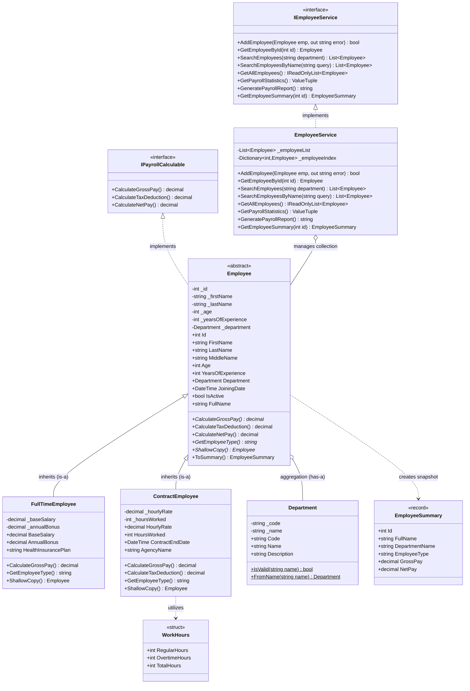
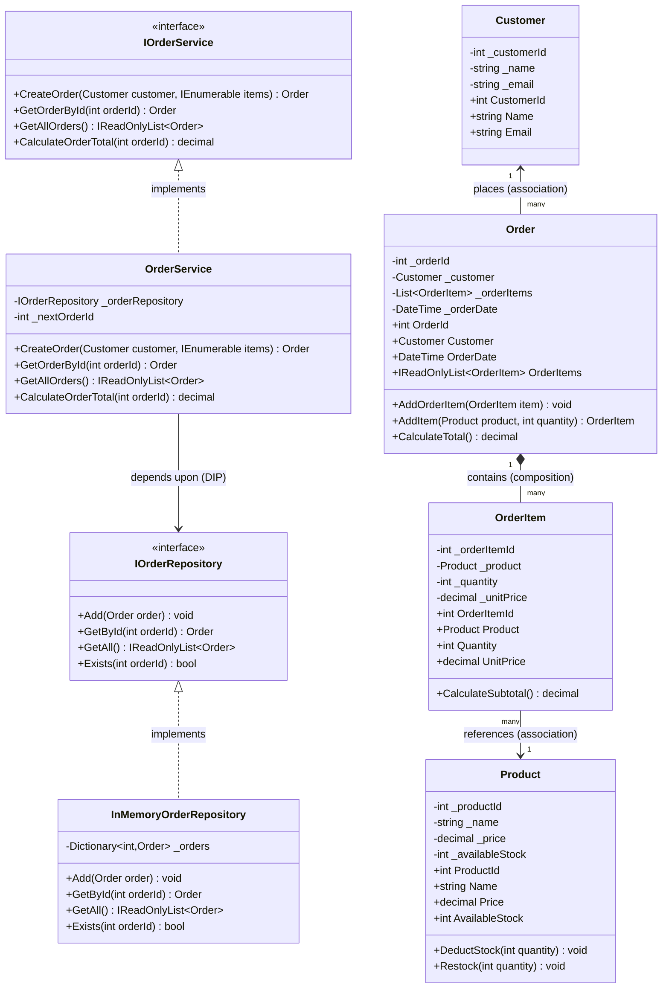

# Domain Model UML Class Diagrams

This document presents the visual object-oriented architecture of the **EmployeeDepartmentManagement** application, covering both the **Employee & Department Domain** and the **Order Management Domain** in `EmployeeDepartmentManagement.Core`.

---

## 1. Employee & Department Management UML Diagram

---

## 2. Order Management Domain UML Diagram

---

## 3. Explanation of Order Management Relationships

### 1. Customer and Order (Association)
- A `Customer` places an `Order`.
- The `Order` holds a reference to the `Customer` who placed it.
- **Lifetime Independence**: If an `Order` is completed or deleted, the `Customer` entity remains valid in the system.

### 2. Order and OrderItem (Composition `*--`)
- An `Order` owns a collection of `OrderItem` instances.
- **Coincident Lifetime**: Line items only exist within the context of their owning order. If an order is discarded, its items are discarded with it.

### 3. OrderItem and Product (Association `-->`)
- An `OrderItem` references a `Product` and records the purchased quantity and historical `UnitPrice`.
- The `Product` exists independently in the catalog and maintains its own `AvailableStock`.

### 4. Interface Implementation (`<|..`)
- `InMemoryOrderRepository` implements `IOrderRepository`.
- `OrderService` implements `IOrderService`.

### 5. Dependency Inversion (`-->`)
- `OrderService` depends on the abstraction `IOrderRepository`, injected via its constructor, rather than coupling directly to `InMemoryOrderRepository`.
