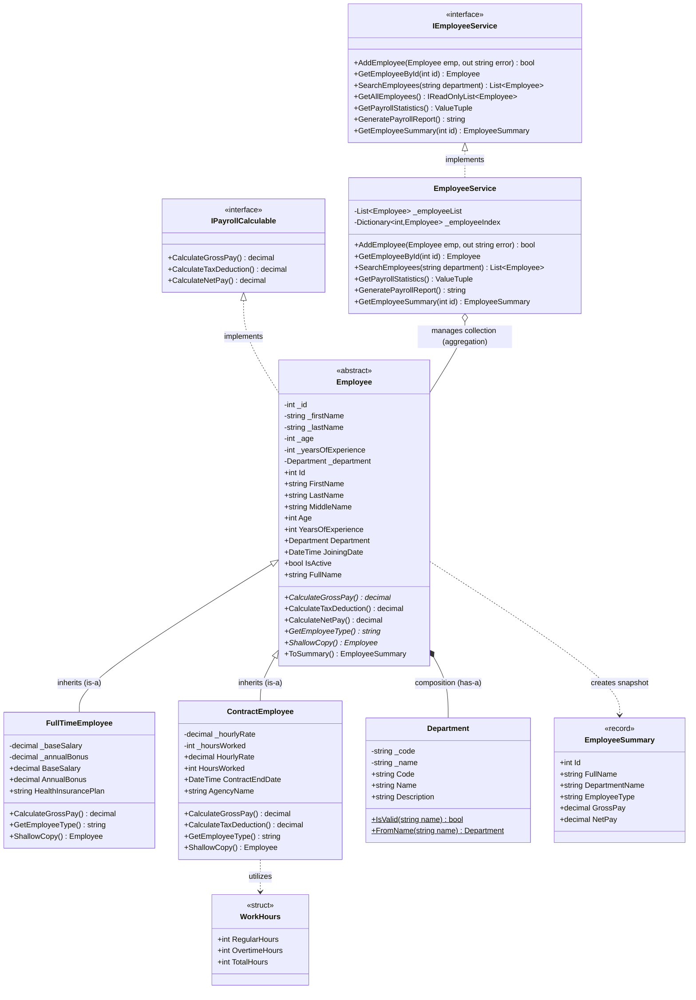

# Domain Model UML Class Diagram

This document presents the visual object-oriented architecture of the **EmployeeDepartmentManagement** domain model library (`EmployeeDepartmentManagement.Core`) and application service layer (`EmployeeDepartmentManagement.App`).

---

## 1. Mermaid UML Class Diagram

---

## 2. Explanation of Class Relationships

### 1. Interface Implementation (`..|>`)
- `Employee` implements `IPayrollCalculable`: The abstract class binds itself to the payroll calculation contract. Any concrete employee subclass must satisfy these payroll calculation methods.
- `EmployeeService` implements `IEmployeeService`: Decouples the console UI from concrete storage implementation details (Dependency Inversion).

### 2. Generalization / Inheritance (`--|>`)
- `FullTimeEmployee` inherits from `Employee`: Permanent salaried employees reuse base properties (`Id`, `FullName`, `Department`, `Age`) and supply specific compensation logic (`BaseSalary + Bonus`).
- `ContractEmployee` inherits from `Employee`: Hourly contractors reuse common employee identities while supplying contractor-specific rules (`HourlyRate * HoursWorked`).

### 3. Composition (`*--`)
- `Employee` *has-a* `Department`: An employee maintains an instance of `Department`. The department object encapsulates corporate department codes and validation logic.

### 4. Aggregation / Collection (`o--`)
- `EmployeeService` maintains `List<Employee>` and `Dictionary<int, Employee>`: The service aggregates multiple employee instances in memory, operating on them polymorphically.

### 5. Dependency / Creation (`..>`)
- `Employee` creates `EmployeeSummary`: A lightweight, immutable record snapshot for data transfer and display.
- `ContractEmployee` utilizes `WorkHours`: A readonly struct value object validating hourly tracking.
