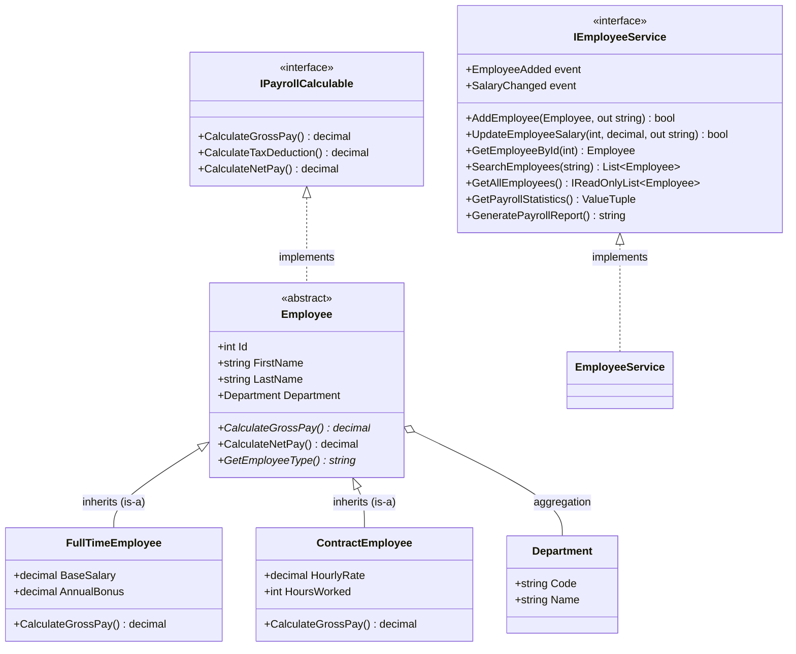
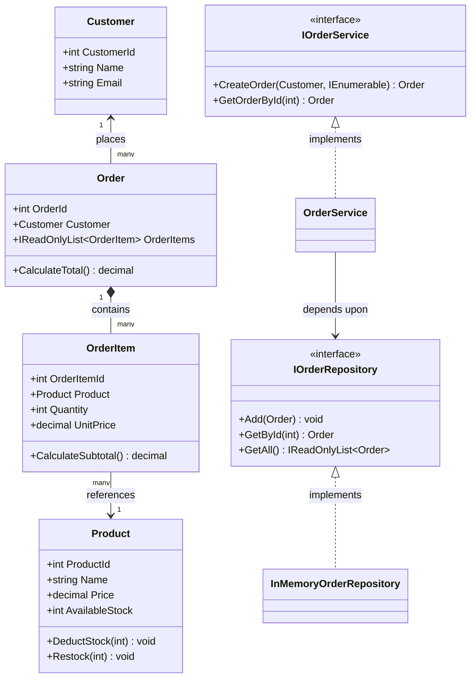

# Domain Model UML Class Diagrams – Week 1 (Day 1, 2, and 3)

This document presents the visual object-oriented and functional architecture across all three days of development.

---

## 1. Day 3: Modern C# & LINQ Architecture Diagram

```mermaid
classDiagram
    %% Core Interfaces & DTOs
    class IEmployeeQueryService {
        <<interface>>
        +FilterByMinimumSalary(IEnumerable employees, decimal minSalary) List~Employee~
        +FilterByDepartment(IEnumerable employees, string dept) List~Employee~
        +SortBySalary(IEnumerable employees, bool ascending) List~Employee~
        +SortByName(IEnumerable employees) List~Employee~
        +GroupByDepartment(IEnumerable employees) List~DepartmentGroup~
        +GetAverageSalaryByDepartment(IEnumerable employees) List~DepartmentSalarySummary~
        +GetHighestPaidEmployee(IEnumerable employees) Employee
        +SearchEmployees(IEnumerable employees, ...) List~Employee~
    }

    class DepartmentSalarySummary {
        <<record>>
        +string DepartmentName
        +int EmployeeCount
        +decimal AverageSalary
        +decimal TotalPayroll
    }

    class DepartmentGroup {
        <<record>>
        +string DepartmentName
        +int EmployeeCount
        +IReadOnlyList~Employee~ Employees
    }

    %% Query Service Implementation
    class EmployeeQueryService {
        +FilterByMinimumSalary(...) List~Employee~
        +FilterByDepartment(...) List~Employee~
        +SortBySalary(...) List~Employee~
        +SortByName(...) List~Employee~
        +GroupByDepartment(...) List~DepartmentGroup~
        +GetAverageSalaryByDepartment(...) List~DepartmentSalarySummary~
        +GetHighestPaidEmployee(...) Employee
        +SearchEmployees(...) List~Employee~
    }

    %% Generic Components
    class GenericFilter~T~ {
        +Filter(IEnumerable~T~ source, Func~T,bool~ predicate) IEnumerable~T~
        +FindFirst(IEnumerable~T~ source, Func~T,bool~ predicate) T
        +CountMatching(IEnumerable~T~ source, Func~T,bool~ predicate) int
    }

    class OperationResult~T~ {
        +bool IsSuccess
        +T Data
        +string Message
        +string ErrorCode
        +Success(T data)$ OperationResult~T~
        +Failure(string msg)$ OperationResult~T~
    }

    %% Extensions & Pattern Matcher
    class EmployeeExtensions {
        <<static>>
        +IsHighEarner(this Employee, decimal) bool
        +ToFormattedString(this Employee) string
        +TotalGrossPayroll(this IEnumerable) decimal
        +FilterByDepartmentName(this IEnumerable, string) IEnumerable
        +AverageGrossSalary(this IEnumerable) decimal
    }

    class EmployeePatternMatcher {
        <<static>>
        +ClassifyEmployeeTier(Employee employee)$ string
        +EvaluateBudgetImpact(Employee employee)$ ValueTuple
    }

    %% Event Arguments
    class EmployeeEventArgs {
        +Employee Employee
        +DateTime EventTimestamp
        +string Action
    }

    class SalaryChangedEventArgs {
        +Employee Employee
        +decimal OldSalary
        +decimal NewSalary
        +DateTime EventTimestamp
    }

    %% Relationships
    IEmployeeQueryService <|.. EmployeeQueryService : implements
    EmployeeQueryService ..> DepartmentGroup : returns
    EmployeeQueryService ..> DepartmentSalarySummary : returns
    EmployeeExtensions ..> Employee : extends
    EmployeePatternMatcher ..> Employee : inspects
    IEmployeeService ..> EmployeeEventArgs : publishes
    IEmployeeService ..> SalaryChangedEventArgs : publishes
```

---

## 2. Preserved Day 2: Employee & Department Hierarchy

---

## 3. Preserved Day 2: Order Management Domain

