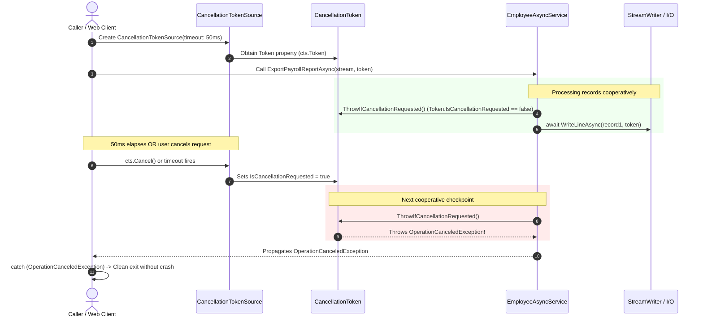

# CancellationToken Implementation Notes

## 1. Overview of Cooperative Cancellation

In modern .NET applications, cancellation is strictly **cooperative**. The runtime does not forcibly abort or kill threads because doing so could corrupt in-flight transactions, leave critical locks open, or leak unmanaged operating system handles.

Instead, a two-part cooperative contract is used:
1. **The Signaling Object (`CancellationTokenSource`):** Initiates the cancellation signal.
2. **The Listening Struct (`CancellationToken`):** Carries the signal to executing methods.

---

## 2. Cancellation Request Flow Diagram



---

## 3. Key CancellationToken APIs

### 3.1 `CancellationTokenSource`
- `new CancellationTokenSource()`: Creates a manual cancellation source.
- `cts.Cancel()`: Manually triggers the cancellation signal immediately.
- `cts.CancelAfter(int millisecondsDelay)`: Schedules an automatic cancellation timer.
- `cts.Token`: Returns the `CancellationToken` struct to pass to methods.

### 3.2 `CancellationToken`
- `token.IsCancellationRequested`: Returns `true` if cancellation has been requested. Useful when you want to handle cancellation conditionally without throwing an exception.
- `token.ThrowIfCancellationRequested()`: Checks `IsCancellationRequested`. If `true`, it immediately throws an `OperationCanceledException`.
- `token.Register(Action callback)`: Registers a callback delegate to execute as soon as cancellation is requested.

---

## 4. Exception Handling Best Practices

When calling cancellation-aware methods, wrap the invocation in a `try/catch` block that specifically catches `OperationCanceledException` (or `TaskCanceledException`, which inherits from `OperationCanceledException`):

```csharp
using var cts = new CancellationTokenSource();
cts.CancelAfter(5000); // 5-second timeout

try
{
    await asyncService.ExportPayrollReportAsync(memoryStream, cts.Token);
    Console.WriteLine("Export completed successfully.");
}
catch (OperationCanceledException) when (cts.IsCancellationRequested)
{
    // Expected cancellation: Clean up temporary files, notify the user
    Console.WriteLine("The export operation timed out or was cancelled by the user.");
}
catch (Exception ex)
{
    // Unexpected error (e.g. out of disk space)
    Console.WriteLine($"An error occurred during export: {ex.Message}");
}
```

---

## 5. Web API Real-World Analogy

In ASP.NET Core web controllers:
```csharp
[HttpGet("employees/export")]
public async Task<IActionResult> ExportEmployees(CancellationToken cancellationToken)
{
    var stream = new MemoryStream();
    // Pass ASP.NET Core's RequestAborted token directly to your service
    await _asyncService.ExportPayrollReportAsync(stream, cancellationToken);
    return File(stream.ToArray(), "text/csv", "employees.csv");
}
```
If the user navigates away or refreshes the page, the browser drops the HTTP connection. ASP.NET Core automatically trips `cancellationToken`, stopping the background export immediately.
