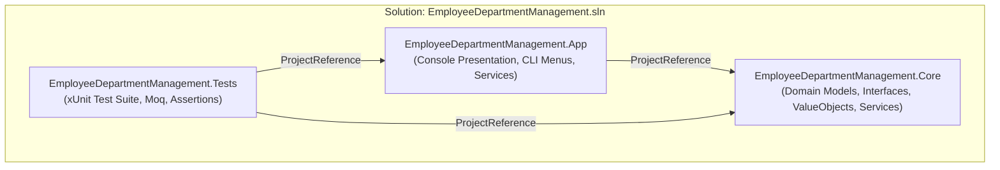
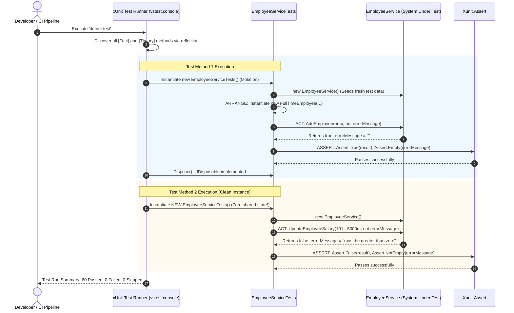
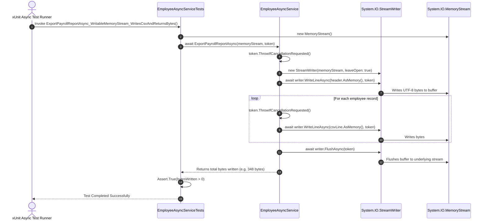

# Execution Flow – Day 4 Unit Testing and Async Operations

## 1. Multi-Project Reference Architecture

The solution uses a clean three-tier project topology separating domain contracts, console presentation, and automated testing:

- **`Core`**: Contains zero dependencies on UI or testing libraries. Pure domain logic, models, and interfaces (`IEmployeeService`, `IEmployeeAsyncService`, `EmployeeAsyncService`).
- **`App`**: References `Core`. Implements concrete console presentation, interactive demonstration handlers, and startup routines.
- **`Tests`**: References both `Core` and `App`. Discovers all public interfaces and classes for automated unit testing.

---

## 2. Unit Test Execution Lifecycle (xUnit Engine)

---

## 3. How Async/Await Flows from Test through Service to Stream

