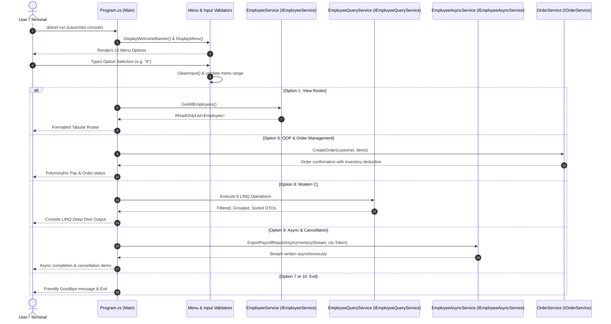

# Week 1 Final Execution Flow & Architectural Lifecycle

## 1. Complete End-to-End Application Lifecycle

---

## 2. File-by-File Responsibility and Connection Map

### 1. `Program.cs` (`App`)
- **Responsibility:** Top-level console entry point (`public static async Task Main`). Renders menus, defensively parses user input, and dispatches to appropriate handlers.
- **Dependencies:** `IEmployeeService`, `IEmployeeQueryService`, `IOrderService`, and demonstration runners.
- **Connects To:** Invokes business methods on `EmployeeService`, `ModernCSharpDemonstration`, and `AsyncDemonstration`.

### 2. `EmployeeService.cs` (`App/Services`)
- **Responsibility:** Manages in-memory employee roster and primary dictionary hash index. Enforces domain validation invariants (`ValidateEmployee`) and raises observer events (`EmployeeAdded`, `SalaryChanged`).
- **Dependencies:** Implements `IEmployeeService` from `Core.Interfaces`.
- **Connects To:** Serves as the data authority for `Program.cs` and `EmployeeAsyncService`.

### 3. `Employee.cs`, `FullTimeEmployee.cs`, `ContractEmployee.cs` (`Core/Models`)
- **Responsibility:** Domain entity hierarchy modeling corporate employees.
- **Polymorphism:** `Employee` defines abstract `CalculateGrossPay()`; `FullTimeEmployee` computes base + bonus, whereas `ContractEmployee` computes hourly rate $\times$ hours worked.
- **Encapsulation:** Properties protect invariants (age 18–75, positive salaries).

### 4. `EmployeeQueryService.cs` (`Core/Services`)
- **Responsibility:** Houses pure, unit-testable LINQ operations (`Where`, `Select`, `OrderBy`, `GroupBy`, `MaxBy`, `Average`, `Sum`).
- **Dependencies:** Implements `IEmployeeQueryService`.
- **Connects To:** Receives `IEnumerable<Employee>` from callers, returning filtered or grouped record snapshots.

### 5. `EmployeeAsyncService.cs` (`Core/Services`)
- **Responsibility:** Implements asynchronous data access, report compilation, and non-blocking stream export with cooperative cancellation support.
- **Dependencies:** Implements `IEmployeeAsyncService`; wraps `IEmployeeService`.
- **Connects To:** Consumed by `AsyncDemonstration.cs` and `EmployeeAsyncServiceTests.cs`.

### 6. `OrderManagement/` (`Core/OrderManagement`)
- **Responsibility:** Models an e-commerce order management system (`Customer`, `Product`, `OrderItem`, `Order`, `IOrderRepository`, `IOrderService`).
- **Connects To:** Demonstrates interface decoupling and repository patterns during Menu Option 6.

### 7. Unit Test Suite (`EmployeeDepartmentManagement.Tests`)
- **Responsibility:** 83 automated xUnit tests validating CRUD, boundaries, null safety, parameterized theories, LINQ queries, async execution, cancellation timeouts, Moq test doubles, and LeetCode solutions.
